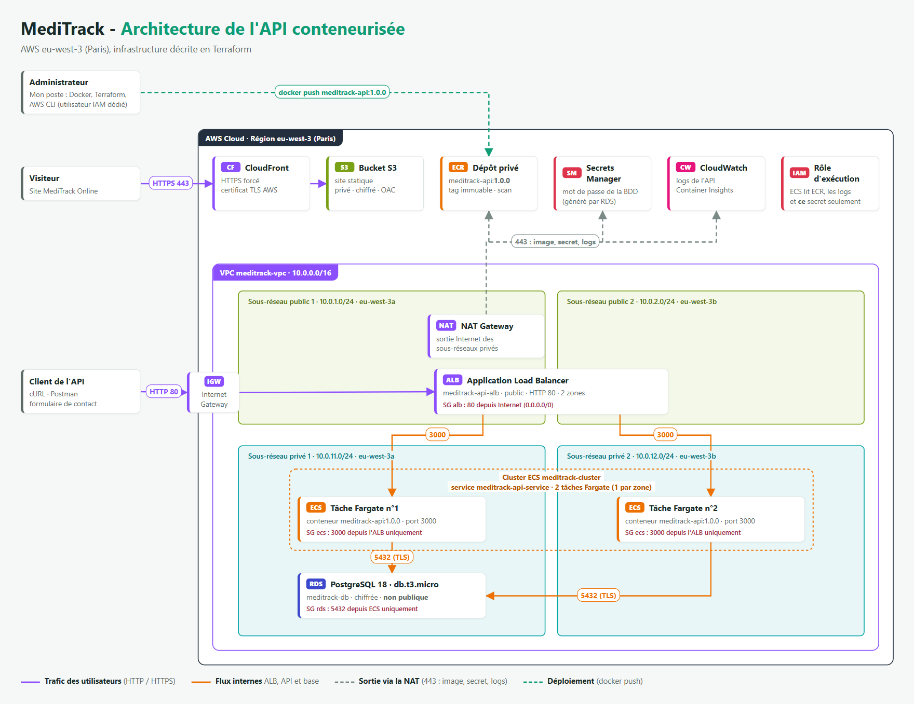

# MediTrack - API conteneurisée sur AWS ECS Fargate

[](https://github.com/Jhanemba64/meditrack-ecs-fargate/actions/workflows/ci.yml)

L'API de contact de MediTrack est conteneurisée avec Docker, stockée dans un dépôt ECR privé et exécutée sur ECS Fargate derrière un Application Load Balancer. Les données sont stockées dans une base RDS PostgreSQL placée dans des sous-réseaux privés. Toute l'infrastructure est décrite en Terraform, y compris le site statique MediTrack Online (S3 et CloudFront).



## Contenu

| Dossier / fichier | Contenu |
|---|---|
| `api-backend/` | API Node.js (Express, PostgreSQL) et son `Dockerfile` multi-étapes |
| `terraform/` | Réseau (VPC, sous-réseaux, NAT), ECR, RDS, ECS, ALB, IAM, S3, CloudFront |
| `docker-compose.test.yml` | Environnement de test : l'API et une base PostgreSQL temporaire (utilisé aussi par la CI) |
| `.github/` | Workflow d'intégration continue et configuration Dependabot |
| `.checkov.yaml` | Configuration de Checkov et risques de sécurité acceptés |
| `aws-iam/` | Politique IAM de l'utilisateur de déploiement |
| `site/` | Site statique MediTrack Online, servi par S3 et CloudFront |
| `captures/` | Captures de la console AWS et des tests ; `sources/` contient le schéma et les pages de preuves en HTML |

## Prérequis

- AWS CLI avec un profil `meditrack` (utilisateur IAM de déploiement), région `eu-west-3`
- Terraform 1.5 ou plus
- Docker

## Déploiement

```bash
# Construction et test local de l'image
docker build --platform linux/amd64 --provenance=false -t meditrack-api:1.1.0 api-backend
docker compose -f docker-compose.test.yml up -d --wait
docker compose -f docker-compose.test.yml down -v

# Dépôt ECR, puis envoi de l'image
cd terraform
terraform init
terraform apply -target=aws_ecr_repository.api -target=aws_ecr_lifecycle_policy.api
aws ecr get-login-password --region eu-west-3 --profile meditrack | \
  docker login --username AWS --password-stdin <compte>.dkr.ecr.eu-west-3.amazonaws.com
docker tag  meditrack-api:1.1.0 <compte>.dkr.ecr.eu-west-3.amazonaws.com/meditrack-api:1.1.0
docker push <compte>.dkr.ecr.eu-west-3.amazonaws.com/meditrack-api:1.1.0

# Reste de l'infrastructure (réseau, RDS, ECS, ALB, site)
terraform apply
terraform output api_url
```

Test de l'API :

```bash
curl -X POST <api_url>/contact -H "Content-Type: application/json" \
     -d '{"nom":"Test","email":"test@example.com","message":"Bonjour"}'
curl <api_url>/contacts
```

## Suppression

```bash
cd terraform
terraform destroy
```

La commande supprime toutes les ressources, dépôt ECR compris.

## Intégration continue

Chaque push et chaque pull request passent par le workflow [`ci.yml`](.github/workflows/ci.yml) :

| Contrôle | Outils |
|---|---|
| Format, validité et bonnes pratiques du Terraform | `terraform fmt`, `terraform validate`, TFLint |
| Analyse de sécurité du Terraform, du Dockerfile et des workflows | Checkov (résultats dans l'onglet Security) |
| Bonnes pratiques du Dockerfile | Hadolint |
| Vulnérabilités de l'image | Trivy, bloquant sur les failles critiques et élevées corrigeables |
| Fonctionnement de l'API avec une vraie base PostgreSQL | Docker Compose et cURL |

Les actions GitHub sont épinglées par SHA de commit et les images des outils par digest. Dependabot propose chaque mois les mises à jour des actions, de l'image de base, des dépendances npm et du provider Terraform.

Les contrôles Checkov non appliqués sont des risques acceptés pour une démonstration : HTTPS sur l'ALB sans nom de domaine, WAF, Multi-AZ, clés KMS dédiées… Chacun est justifié dans [`.checkov.yaml`](.checkov.yaml), avec ce qu'il faudrait en production.

## Sécurité

- Base RDS et tâches ECS dans des sous-réseaux privés, sans IP publique
- Seul le port 80 de l'ALB est exposé à Internet
- Groupes de sécurité en chaîne : ALB vers ECS sur 3000, ECS vers RDS sur 5432
- Mot de passe de la base généré par RDS, stocké dans Secrets Manager et injecté au démarrage des tâches
- Chiffrement au repos (RDS, ECR, S3) et connexion TLS vers la base (`rds.force_ssl = 1`)
- Dépôt ECR privé, tags immuables, analyse des vulnérabilités à chaque envoi
- Image `node:22-alpine` construite en deux étapes : dépendances figées par `package-lock.json`, npm retiré de l'image finale, exécution sans les droits root. L'image 1.0.0 (Dockerfile d'origine sur `node:18-alpine`) comptait 5 failles critiques et 20 élevées ; la 1.1.0 n'en a aucune
- Groupe de sécurité par défaut du VPC vidé de toutes ses règles
- En-têtes de sécurité HTTP ajoutés par CloudFront (HSTS, X-Frame-Options, X-Content-Type-Options, Referrer-Policy)
- Journaux de l'API et de PostgreSQL centralisés dans CloudWatch
- Ressources hébergées dans la région Paris (`eu-west-3`)

## Licence

[MIT](LICENSE)
